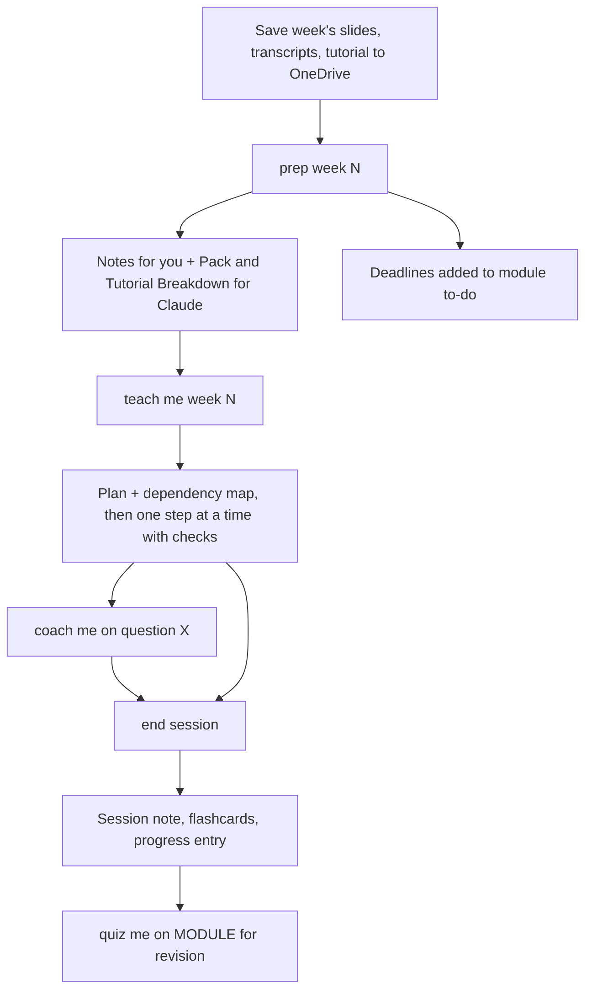

# claude-study-vault

A study kit that turns Claude into a tutor for your university modules. Each week you give Claude your lecture slides, transcripts and tutorial sheet. Claude then writes study notes, teaches you one step at a time with check questions, coaches you through the tutorial with hints, and keeps your flashcards, progress log and to-do list up to date.

> **Credit:** inspired by Amos Blomqvist's [**learn**](https://github.com/amosblomqvist/learn) ("My AI learning system") and the video [*How I Use AI to Learn Things*](https://www.youtube.com/watch?v=kzcI5F4tGiU). I first tailored it for my own studies, then generalised it for other students at my university. See [Credits](#credits).

It's set up for **University of Nottingham** students (OneDrive, OneNote and Moodle by default), but you can change every part of it: the notes app, the storage and the way you use Claude.

The core is one instruction file, [`kit/TEACHING-METHOD.md`](kit/TEACHING-METHOD.md). It teaches for understanding rather than memorising. You start from a few **unconditional truths**, then each later idea is built so it feels discovered ("how could I have discovered this?"), with a check question after each step.

## Pick your setup

| | Default (recommended for UoN) | Also works |
|---|---|---|
| **Claude** | **Claude Projects**: laptop, iPad, phone | Free chat (attach files each time) · Cowork in the Claude desktop app (writes files for you) |
| **Notes app** | **OneNote**: included with your UoN account | **Obsidian** (recommended upgrade: diagrams, LaTeX, spaced repetition) · Notion · any Markdown app |
| **Lecture files** | **OneDrive**: UoN account, on every device | iCloud · Google Drive · Dropbox · local |
| **Course page** | **Moodle** | any (Canvas, Blackboard…) |

You record your choices in [`kit/MY-SETUP.md`](kit/MY-SETUP.md), and Claude adapts how it hands things back. For OneNote that's formatted text to paste in; for Obsidian it's Markdown with diagrams; with Cowork it writes the files itself.

## The weekly flow



## Requirements

- A **Claude account**. Projects are the default; if your plan doesn't have Projects, use free chat.
- A **notes app**: OneNote (free with UoN Microsoft 365) by default.
- Somewhere to keep lecture files: **OneDrive** (UoN) by default.
- Optional: the **Claude desktop app with Cowork**, so Claude reads and writes files on your laptop directly.
- Optional: **Claude in Chrome**, so `check MODULE` can read Moodle for you (read only).
- Optional: **Obsidian** with the **Spaced Repetition** plugin; or Anki/Quizlet for flashcards.
- Optional: an **iPhone Shortcut** that syncs to-dos with Apple Reminders (Markdown Home pages only).

## Quick start

1. Download this repo (green **Code** button › **Download ZIP**) and unzip it.
2. Read [`START HERE.md`](START%20HERE.md) and pick your setup.
3. Fill in [`kit/MY-SETUP.md`](kit/MY-SETUP.md).
4. Follow the guide for your Claude route:
   - [Claude Projects](guides/claude-projects.md) (default)
   - [Free chat](guides/claude-free-chat.md)
   - [Cowork](guides/claude-cowork.md)
5. Say `set up new module CODE Name in Term 1`, put Week 1's files in OneDrive, then `prep week 1 of CODE`.

## Commands

| You say | What happens |
|---|---|
| `set up new module CODE Name in Term N` | Module notes, progress log and Home page (to-do, key dates, announcements) |
| `prep week N of CODE` | Reads the week's files; writes Notes, Pack, Tutorial Breakdown; finds deadlines |
| `teach me week N, I have 45 minutes` | Plan and dependency map first, then one idea at a time with check questions |
| `coach me on week N question X` | You attempt it first; Claude gives hints one rung at a time |
| `quiz me on CODE` / `review CODE` | Mixed retrieval practice, weakest topics first |
| `check CODE` / `what's due?` | Reads Moodle (read only) or text you paste, and updates the Home page |
| `research X` | Web research, only when you ask, when the module files are too thin |
| `end session` | Session note, flashcards, progress entry, updated to-dos |

## On iPad

The default setup (Projects + OneNote + OneDrive) works fully on iPad. Attach lecture files from **Files › OneDrive** in the Claude app, learn there, and paste the notes into OneNote. Obsidian works on iPad too, but its vault must be in iCloud Drive or Obsidian Sync, not OneDrive. See the [Obsidian guide](guides/obsidian.md).

## What's in the repo

```
START HERE.md         pick a setup, then the weekly routine
kit/                  what Claude reads
  TEACHING-METHOD.md  the method and modes
  MY-SETUP.md         your choices (notes app, storage, Claude route)
  templates/          Notes, Pack, Tutorial Breakdown, Session, Home, module notes, progress
guides/               one short guide per Claude route, notes app, storage, iPhone sync
starter-folders/      Term 1/EXAMPLE101 Example Module/ ready to copy into OneDrive or a vault
```

## Limitations

- **Claude can't run your code** in most setups. Any code, proof or query it couldn't actually run is labelled `unchecked`; run it yourself.
- **Claude can be wrong.** The method makes it check facts against your materials and label anything from outside the course, but your lecture materials remain the authority.
- **Projects and free chat can't save files.** Claude hands back what changed, and you save it. If you skip that, the next session won't know what you covered.
- **OneNote** can't show Mermaid diagrams, and it only handles LaTeX through its equation tool. Claude gives outlines or rendered visuals to screenshot instead.
- **The iPhone Shortcut is untested** on a real phone and overwrites the Home page file. Test it by hand and keep a backup.
- **Sync caveats:** let OneDrive (or iCloud) finish syncing before switching devices, or edits can conflict. Obsidian on iPad can't open a vault stored in OneDrive.
- Free-plan usage limits are tight; large slide decks use a lot of them. Scanned PDFs with no text can't be read.
- App and menu names in Claude, OneNote and Obsidian change between versions.

## Academic integrity

- **Assessed work gets hints only.** If tutorials count towards your mark, or the tutorial policy is `unknown`, Claude never gives final answers; it coaches with a hint ladder. Never paste assessed coursework, quizzes or exam questions in for answers.
- **Check the University's and your module's guidance on generative AI** before using this, and follow it. Policies differ between modules.
- Full worked solutions are only shown for tutorials marked `formative only`, and only after you've made a real attempt.

## Don't share course material

Lecture slides, transcripts and tutorial sheets are the University's copyrighted material. Don't upload them anywhere public. Share only this kit.

## Credits

- **Original idea and inspiration:** [amosblomqvist/learn](https://github.com/amosblomqvist/learn) by Amos Blomqvist, explained in the YouTube video [*How I Use AI to Learn Things*](https://www.youtube.com/watch?v=kzcI5F4tGiU). Watch it: it explains the thinking behind this kit better than this README does.
- **This version:** first adapted for one student's own modules (Obsidian + Claude), then generalised for other University of Nottingham students. It adds OneNote/OneDrive/Claude Projects defaults, per-app output formats, UoN Moodle checks, and the optional iPhone Reminders sync.

## License

[MIT](LICENSE). This repo is written independently; the original [learn](https://github.com/amosblomqvist/learn) repo is the work of its author and is credited above.
