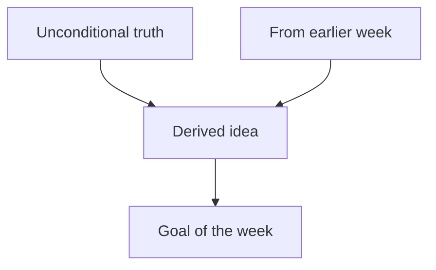

# MODULE Week N: Notes

> [!note] How to use
> Written study notes for the week, built from the lecture files. Read top to bottom: each section rests on the ones above it. Draft at prep; refined after each session. Links: [[Week N - Pack]] · [[Week N - Tutorial Breakdown]] · [[Week N - Flashcards]]

## The big picture

Two to four sentences: what problem this week solves and why we need it. Link back to earlier weeks' notes, e.g. [[Week 1 - Notes]].

## Foundations

The unconditional truths and real definitions everything else rests on. State each plainly, in the lecturer's wording and notation, with a source.

- **Term**: definition. `slides01 p.N`

## 1. First idea

- **Why we need it:** the problem it solves.
- **The idea:** explained so it could have been discovered, built from the foundations above. `source`
- **Connects to:** which earlier node(s) it rests on.
- **Example:** a worked example from the materials (cite it), or one clearly labelled as Claude's own.

> [!warning] Common mistake
> Only if the lecturer or the materials flag one, or the learner made it in a session.

## 2. Next idea

Same shape. Add a visual only where it earns its place.

## Worked examples

Short, fully explained examples in the course's notation. Label any code Claude could not run `unchecked` until you have run it yourself.

## Summary

Five to eight bullet points that compress the week into its generating ideas.

## Open questions

Anything unclear, not covered by the materials, or where sources disagree.
