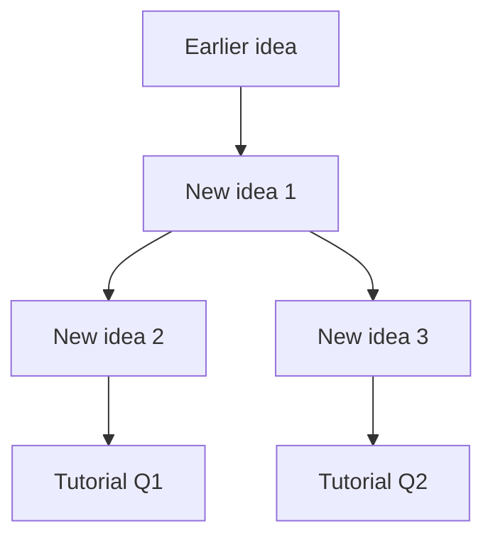

# MODULE Week NN: Pack

**Sources:** list every one of your files in this week's folder here, e.g. `Lecture 1 slides (70 pp)`, `Lecture 1 transcript`, `Tutorial 1`, `Reading: ...`
**Unreadable or missing:** note scanned files, missing tutorial, no transcript, etc. Write "none" if all fine.

## Week at a glance

Three to five sentences: what this week is about, why it matters for the module, and how it links to earlier weeks. Link earlier packs, e.g. [[Week 01 - Pack]].

## Concept map

Replace with the real dependency graph: unconditional truths and earlier-week ideas at the roots, tutorial questions as sinks. Mark which nodes come from earlier weeks.

## Teaching order

Follow the dependency graph, not necessarily lecture order. Say why if you reorder.

- [ ] **1. Concept name**: one-line summary. `slides 3-7`, `transcript`. Unlocks: Tutorial Q1
- [ ] **2. Concept name**: one-line summary. `slides 8-12`. Needs: node 1. Unlocks: Q2
- [ ] **3. ...**

## From earlier weeks (assumed)

| Idea | Week | Confirmed in PROGRESS? |
|---|---|---|
| ... | 01 | yes / no / weak |

## Key definitions and notation

Use the course's own wording and symbols. Cite the source for each.

- **Term**: definition. `slide N`

## Lecturer emphasis

What the lecturer stressed, warned about, or called important or a common mistake. Cite the transcript passage. Write "none noted" if nothing stood out.

## Tutorial map

| Question | Needs these concepts | Difficulty | Status |
|---|---|---|---|
| Q1 | [[#1. Concept name]] | easy | not started |

If no tutorial has been uploaded: **pending**.

## Gaps and conflicts

Anything the materials don't cover, or where sources disagree or look wrong. Write "none found" if clean.
